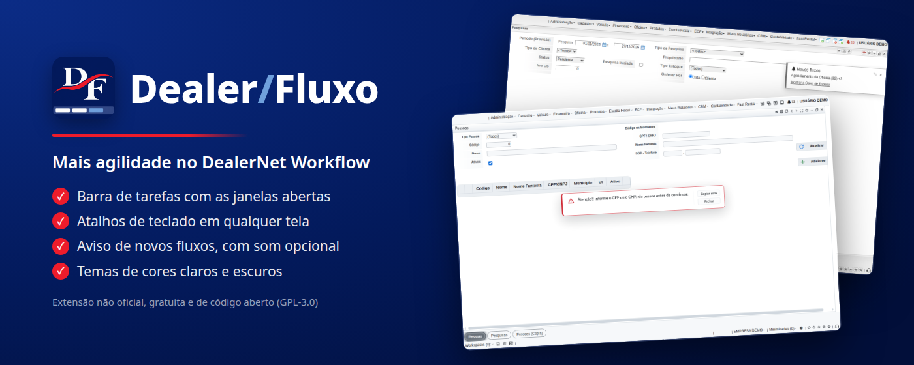
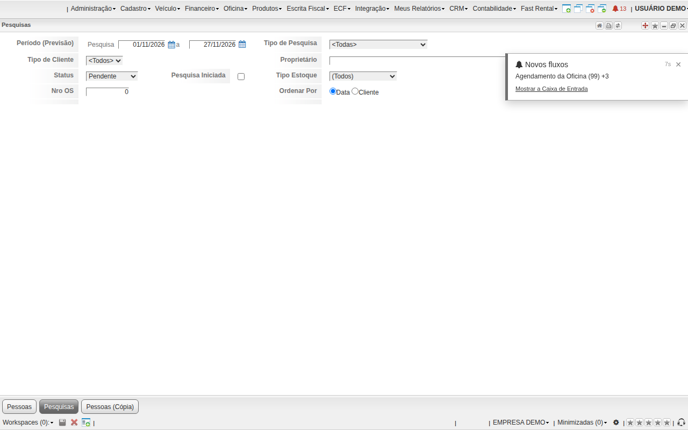
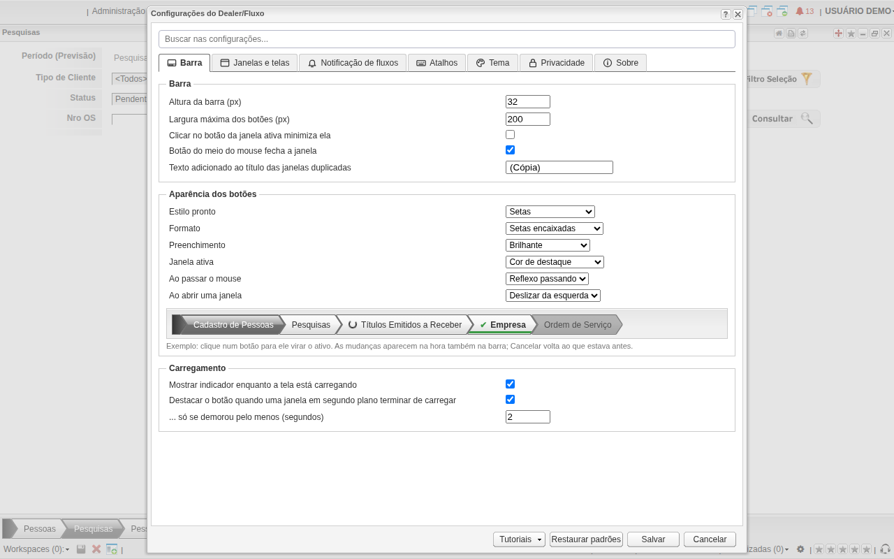
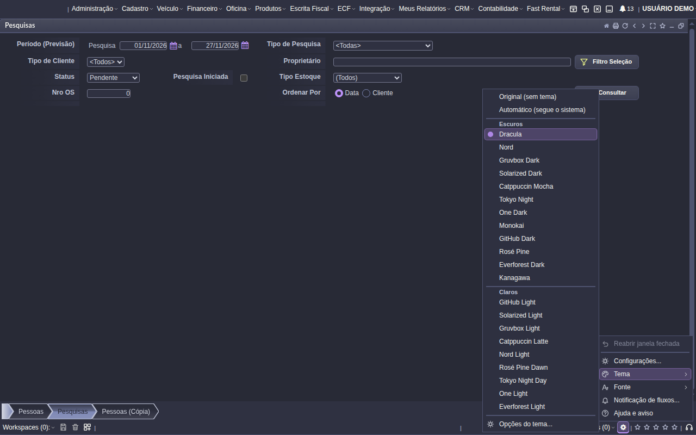
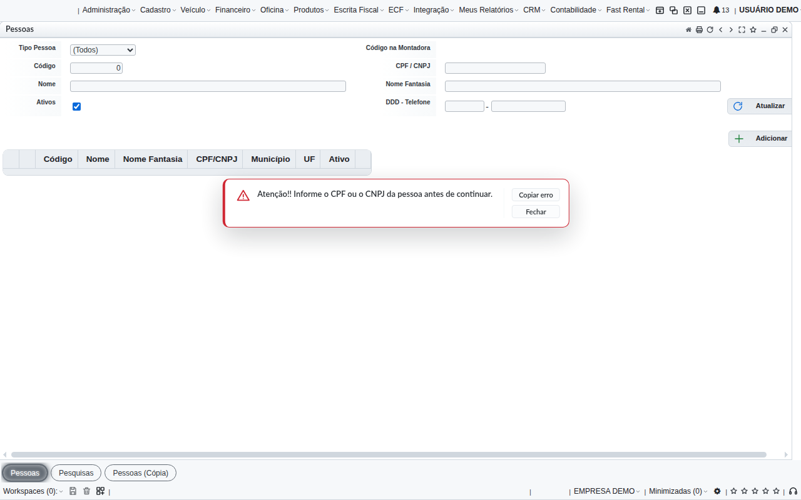
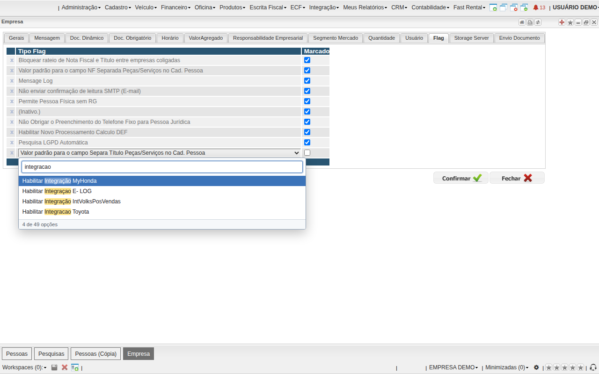
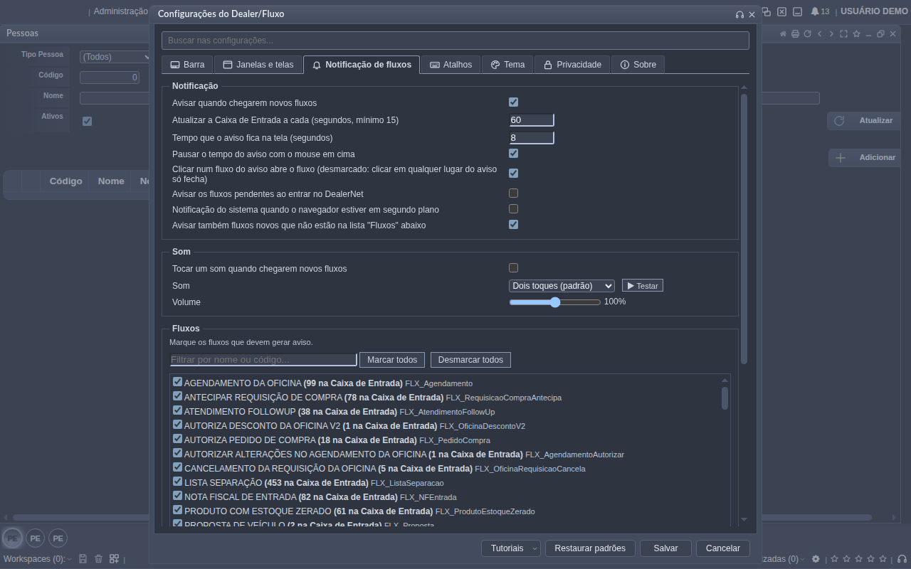
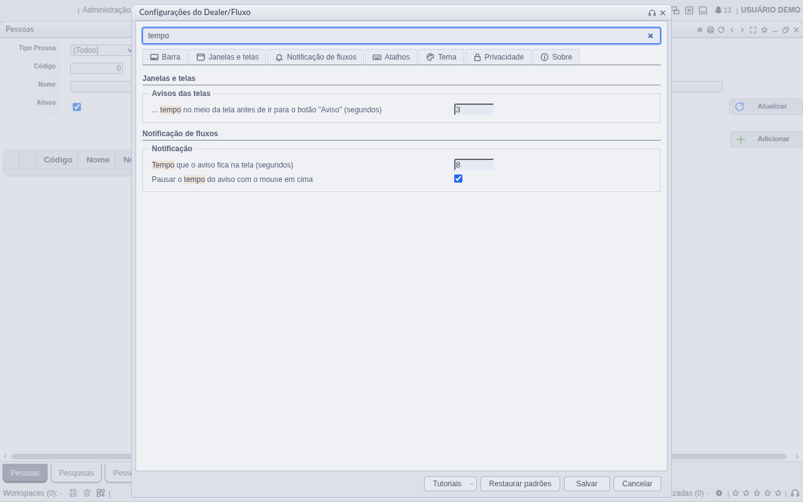

<p align="center">
  
</p>

<h1 align="center">Dealer/Fluxo</h1>

<p align="center">
  Extensão para o navegador que deixa o <b>DealerNet Workflow</b> mais ágil: barra de tarefas com as janelas
  abertas, atalhos de teclado, aviso de novos fluxos e muito mais.
</p>

<p align="center">
  <a href="https://chromewebstore.google.com/detail/dealerfluxo/dgnlfhccofihphmfacpjbgmodbcligaf"></a>
  <a href="https://chromewebstore.google.com/detail/dealerfluxo/dgnlfhccofihphmfacpjbgmodbcligaf"></a>
  <a href="https://addons.mozilla.org/pt-BR/firefox/addon/dealer-fluxo"></a>
</p>

<p align="center">
  
</p>

## Recursos

- **Barra de tarefas** no rodapé com as janelas abertas: clique para alternar, arraste para reordenar, botão do
  meio fecha, clique direito para minimizar, duplicar, voltar ao início e reabrir janelas fechadas.
- **Aparência dos botões** à escolha: formatos, preenchimentos e efeitos, com estilos prontos.
- **Busca no menu**: a lupa (na barra de status, ou no começo da barra de tarefas quando há janelas abertas) ou Alt+M
  acha qualquer tela do menu pelo nome, sem passar pelos submenus, e mostra onde ela fica (com o módulo em negrito). A lupa
  pode ficar também no alto ou escondida.
- **Atalhos de teclado** que funcionam com o cursor dentro das telas, todos configuráveis.
- **Aviso de novos fluxos** na Caixa de Entrada, com som opcional e escolha de quais fluxos avisar.
- **Avisos das telas em destaque**: as mensagens em vermelho aparecem no meio da tela, com botão para copiar.
- **Busca nas listas de opções** com muitos itens, tolerante a erros de digitação e acentos, sem mudar o jeito
  de usar a lista.
- **Impressão da OS**: os documentos marcados abrem cada um numa janela, prontos para imprimir.
- **Temas de cores** claros e escuros, fonte e tamanho do texto (em testes).
- **Busca nas configurações** e funcionamento também em endereços próprios do DealerNet.

## Capturas de tela

<table>
  <tr>
    <td></td>
    <td></td>
  </tr>
  <tr>
    <td align="center">Barra de tarefas e aviso de novos fluxos</td>
    <td align="center">Aparência dos botões</td>
  </tr>
  <tr>
    <td></td>
    <td></td>
  </tr>
  <tr>
    <td align="center">Temas de cores</td>
    <td align="center">Avisos das telas em destaque</td>
  </tr>
  <tr>
    <td></td>
    <td></td>
  </tr>
  <tr>
    <td align="center">Busca nas listas de opções</td>
    <td align="center">Notificação de fluxos</td>
  </tr>
  <tr>
    <td></td>
    <td></td>
  </tr>
  <tr>
    <td align="center">Busca nas configurações</td>
    <td></td>
  </tr>
</table>

## Instalação

- **Chrome e Edge:** instale pela [Chrome Web Store](https://chromewebstore.google.com/detail/dealerfluxo/dgnlfhccofihphmfacpjbgmodbcligaf).
  No Edge, aceite "Permitir extensões de outras lojas" quando ele perguntar.
- **Firefox:** em breve em [addons.mozilla.org](https://addons.mozilla.org/pt-BR/firefox/addon/dealer-fluxo).

Depois de instalar, entre no DealerNet: a barra aparece sozinha. As opções ficam na engrenagem, no canto inferior
direito da tela.

Se o DealerNet da sua empresa usa um endereço próprio (fora de `dealernetworkflow.com.br`), entre nele, clique no
botão da extensão na barra do navegador e escolha **Ativar Dealer/Fluxo neste site**.

## Permissões

| Permissão | Para que serve |
|---|---|
| Acesso às páginas do DealerNet | Mostrar a barra, os atalhos e os avisos no portal (`*.dealernetworkflow.com.br`). |
| `storage` | Guardar as preferências da extensão e a lista de endereços ativados. |
| `scripting` | Funcionar nos endereços próprios do DealerNet que o usuário ativar. |
| `activeTab` | Permitir que o botão da extensão ative o site aberto naquele momento. |
| `alarms` | Enviar as estatísticas de uso uma vez por dia. |
| Acesso a outros sites (opcional) | Pedido um a um, só quando o usuário ativa um endereço próprio do DealerNet. |

## Privacidade

A extensão envia, uma vez por dia, estatísticas de uso **anônimas** (versão, navegador, sistema e algumas
preferências), sem nenhum identificador, usuário, empresa ou conteúdo das telas. Dá para ver exatamente o que é
enviado e desligar em **Configurações > Privacidade**; empresas podem desligar para todos por política do navegador
(`telemetria: false`). Detalhes na [política de privacidade](https://dealer-fluxo-ping.igorslime.workers.dev/privacidade).
O servidor que recebe as estatísticas também está neste repositório, em [`servidor/`](servidor/).

## Compilar a partir do código

Precisa só do Python 3.

```bash
python3 extensao/build.py
```

Isso gera as pastas `extensao/build/chrome` e `extensao/build/firefox` (e os pacotes `.zip` em `extensao/dist/`).
Para carregar sem instalar pela loja:

- **Chrome/Edge:** `chrome://extensions` → *Modo do desenvolvedor* → *Carregar sem compactação* → `extensao/build/chrome`.
- **Firefox:** `about:debugging#/runtime/this-firefox` → *Carregar extensão temporária* → `extensao/build/firefox/manifest.json`.

Os testes automáticos rodam a cada envio para o GitHub; veja [`testes/README.md`](testes/README.md).

## Estrutura

| Pasta | Conteúdo |
|---|---|
| `userscript.js` | O código que roda no portal (barra, atalhos, avisos, configurações). |
| `extensao/` | A parte própria da extensão, o build, os ícones e o material das lojas ([detalhes](extensao/README.md)). |
| `servidor/` | O servidor das estatísticas de uso ([detalhes](servidor/README.md)). |
| `testes/` | Testes automáticos com Playwright num DealerNet de verdade ([detalhes](testes/README.md)). |
| `legado/` | Os scripts antigos do Tampermonkey (DealerBarraDeTarefas e DealerNotificaFluxo), descontinuados. |

---

<p align="center"><sub>O Dealer/Fluxo não é um produto oficial e não tem relação com a DealerNet. Problemas e sugestões: abra uma <a href="../../issues">issue</a>.</sub></p>
